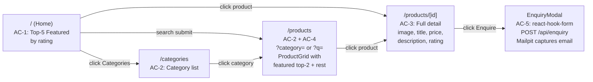

# Product Catalogue PoC — Implementation Plan (v2)

> Revised incorporating user feedback on API design, featured/top-2 ranking, search trigger, caching scope, routing, and enquiry modal.

## Goal

Build a minimal, clean, 2–3 hour PoC product catalogue backed by [FakeStoreAPI](https://fakestoreapi.com). The backend proxies all external calls; the React/Next.js frontend only talks to our own `/api/*` routes. An email enquiry flow lets users contact sales. Everything runs locally with Docker Compose + Mailpit.

---

## Accepted Decisions (from review)

| # | Decision |
|---|----------|
| 1 | **Featured = top-5 by rating** (`rating.rate` desc) — no env var needed; `FEATURED_PRODUCT_IDS` removed. |
| 2 | **Category top-2** are the two highest-rated products in that category (`rating.rate` desc). |
| 3 | **Search triggers on form-submit** (Enter or button click) only — no debounce / live query. |
| 4 | **No pagination** anywhere — show all results. |
| 5 | **Single `/api/products` endpoint** with optional query params replaces three separate product endpoints. |
| 6 | **Cache only `all_products` + `categories`** — per-category and per-product fetches go directly to FakeStoreAPI. |
| 7 | **Frontend routes**: `/` (home/featured), `/categories` (list), `/products?category=` (filtered grid), `/products/[id]` (detail). Search lives as a query param `?q=` on `/products`. |
| 8 | **Enquiry form** opens as a **modal** from the product detail page — not an inline section. |

> [!WARNING]
> `VITE_API_BASE_URL` in `.env.example` uses the Vite prefix — but the front-end uses **Next.js**. This plan corrects it to `NEXT_PUBLIC_API_BASE_URL`. We will update `.env.example` as part of the implementation.

---

## Proposed Changes

### 1. Folder Structure

```
product-catalogue-poc/
├── AGENTS.md
├── PLAN.md                        ← [NEW] written to repo root
├── .env.example                   ← [MODIFY] fix VITE_ → NEXT_PUBLIC_
├── docker-compose.yml             ← [NEW]
│
├── back-end/
│   ├── package.json
│   ├── tsconfig.json
│   ├── jest.config.ts
│   ├── .env                       ← git-ignored, copy of .env.example
│   └── src/
│       ├── index.ts               ← Express bootstrap (listen only)
│       ├── app.ts                 ← Express app factory — exported for tests
│       ├── types/
│       │   └── domain.ts          ← Product, EnquiryRequest, CatalogProvider, EmailProvider
│       ├── adapters/
│       │   ├── FakeStoreCatalogAdapter.ts
│       │   └── EmailAdapter.ts
│       ├── validators/
│       │   ├── productsValidator.ts
│       │   └── enquiryValidator.ts
│       ├── controllers/
│       │   ├── productsController.ts
│       │   ├── categoriesController.ts
│       │   └── enquiryController.ts
│       ├── routes/
│       │   ├── products.ts        ← GET /api/products  (query: category?, q?)
│       │   ├── categories.ts      ← GET /api/categories
│       │   └── enquiry.ts         ← POST /api/enquiry
│       └── __tests__/
│           ├── products.test.ts
│           ├── categories.test.ts
│           └── enquiry.test.ts
│
└── front-end/
    ├── package.json
    ├── tsconfig.json
    ├── next.config.ts
    ├── tailwind.config.ts
    ├── jest.config.ts
    ├── .env.local                 ← git-ignored
    └── src/
        ├── app/
        │   ├── layout.tsx          ← Navbar + QueryClientProvider wrapper
        │   ├── page.tsx            ← AC-1: Home — top-5 featured by rating
        │   ├── categories/
        │   │   └── page.tsx        ← AC-2: Category list
        │   ├── products/
        │   │   ├── page.tsx        ← AC-2 + AC-4: Grid with ?category= and ?q= filters
        │   │   └── [id]/
        │   │       └── page.tsx    ← AC-3 + AC-5: Detail + Enquiry modal trigger
        ├── api/                    ← Pure async fetch functions — no fetch in components
        │   ├── products.ts         ← getProducts(params?), getProductById(id)
        │   ├── categories.ts       ← getCategories()
        │   └── enquiry.ts          ← sendEnquiry(payload)
        ├── components/
        │   ├── Navbar.tsx          ← Logo + SearchBar + Categories link
        │   ├── SearchBar.tsx       ← Submits on Enter/button — pushes ?q= to URL
        │   ├── ProductCard.tsx     ← Tile: image, title, price, rating (no fetch/state)
        │   ├── ProductGrid.tsx     ← Renders ProductCard list; accepts featured[] + rest[]
        │   ├── CategoryList.tsx    ← Renders category chips → links to /products?category=
        │   ├── EnquiryModal.tsx    ← Dialog overlay with EnquiryForm inside
        │   └── EnquiryForm.tsx     ← react-hook-form; useMutation; success/error state
        └── __tests__/
            ├── ProductCard.test.tsx
            └── EnquiryForm.test.tsx
```

---

### 2. Domain Types & Interfaces

#### [NEW] `back-end/src/types/domain.ts`

```typescript
// ── Core domain type (internal — never leaks raw FakeStore shape) ─────────────
export interface Product {
  id: number;
  title: string;
  price: number;
  description: string;
  category: string;
  imageUrl: string;                     // mapped from FakeStore's "image"
  rating: { rate: number; count: number };
}

// ── Enquiry payload (Zod-validated on ingress) ────────────────────────────────
export interface EnquiryRequest {
  productId: number;
  productTitle: string;
  name: string;
  email: string;
  message: string;
}

// ── Provider interfaces ───────────────────────────────────────────────────────
export interface CatalogProvider {
  getFeaturedProducts(): Promise<Product[]>;        // top-5 by rating.rate
  getCategories(): Promise<string[]>;
  getProductsByCategory(category: string): Promise<Product[]>;
  searchProducts(query: string): Promise<Product[]>;
  getProductById(id: number): Promise<Product>;
}

export interface EmailProvider {
  sendEnquiry(enquiry: EnquiryRequest): Promise<void>;
}
```

**FakeStore → Domain mapping** (inside `FakeStoreCatalogAdapter`, never exposed upward):
```
FakeStore.image  →  Product.imageUrl
FakeStore.rating →  Product.rating  (rate, count — same shape, re-typed)
```

---

### 3. Backend REST API Contracts

#### Unified product endpoint

The three separate product endpoints are **merged into one**:

```
GET /api/products
```

| Query param | Type | Rule | Effect |
|---|---|---|---|
| _(none)_ | — | — | Returns top-5 products by `rating.rate` desc (featured / home) |
| `category` | `string` | non-empty | Returns `{ featured: Product[], rest: Product[] }` for that category, sorted by rating; first 2 → `featured`, remainder → `rest` |
| `q` | `string` | min 1 char | Returns products where title **or** description contains `q` (case-insensitive) |

> `category` and `q` are mutually exclusive. If both are sent, `category` takes precedence (or return 400 — TBD at implementation; this plan goes with `category` wins).

#### Full route table

| Method | Route | Query Params | Response 200 | Errors |
|--------|-------|-------------|--------------|--------|
| `GET` | `/api/products` | _(none)_ | `Product[]` ≤ 5 (top-rated) | 500 |
| `GET` | `/api/products` | `?category=electronics` | `{ featured: Product[], rest: Product[] }` | 400 missing/empty, 500 |
| `GET` | `/api/products` | `?q=jacket` | `Product[]` | 400 empty q, 500 |
| `GET` | `/api/products/:id` | — | `Product` | 404, 500 |
| `GET` | `/api/categories` | — | `string[]` | 500 |
| `POST` | `/api/enquiry` | — | `{ message: "Enquiry sent" }` | 400 (Zod), 500 |

**Consistent error shape:**
```json
{ "error": "Human-readable message", "details": { ... } }
```

**POST `/api/enquiry` body (Zod schema):**
```typescript
z.object({
  productId:    z.number().int().positive(),
  productTitle: z.string().min(1),
  name:         z.string().min(1),
  email:        z.string().email(),
  message:      z.string().min(1).max(1000),
})
```

**Route registration order** (Express `products.ts`):
```
router.get('/',    productsHandler)   // handles /, ?category=, ?q=
router.get('/:id', productByIdHandler)
```
No conflict — query-param routes use `/`, not a named path segment.

---

### 4. Caching & Filtering Logic

#### What is cached

| Cache key | TTL | Cached? | Rationale |
|---|---|---|---|
| `all_products` | `CACHE_TTL_SECONDS` (default 300 s) | ✅ Yes | Used for featured (sort all) and search (filter all) |
| `categories` | `CACHE_TTL_SECONDS` | ✅ Yes | Static-ish; cheap to cache |
| per-category | — | ❌ No | FakeStoreAPI has a direct category endpoint; called inline |
| per-product (`/:id`) | — | ❌ No | Detail page; fresh fetch each time |

#### Cache implementation (inside `FakeStoreCatalogAdapter`)

```
cache: Map<string, { data: unknown; expiresAt: number }>

private async cachedFetch<T>(key: string, fetcher: () => Promise<T>): Promise<T> {
  const hit = this.cache.get(key)
  if (hit && Date.now() < hit.expiresAt) return hit.data as T
  const data = await fetcher()
  this.cache.set(key, { data, expiresAt: Date.now() + this.ttlMs })
  return data
}
```

#### Featured products (no env var — pure rating sort)

```
getFeaturedProducts():
  allProducts = cachedFetch('all_products', fetchAllFromFakeStore)
  return allProducts
    .sort((a, b) => b.rating.rate - a.rating.rate)
    .slice(0, 5)
```

#### Category products (top-2 by rating)

```
getProductsByCategory(category):
  raw = await fetch(`fakestoreapi.com/products/category/${category}`)  // no cache
  sorted = raw.sort((a, b) => b.rating.rate - a.rating.rate)
  return sorted   // caller splits into featured[0..1] / rest[2..]
```

Route handler splits the sorted list:
```typescript
const products = await catalog.getProductsByCategory(category)
res.json({ featured: products.slice(0, 2), rest: products.slice(2) })
```

#### Search

```
searchProducts(q):
  allProducts = cachedFetch('all_products', fetchAllFromFakeStore)
  const lq = q.toLowerCase()
  return allProducts.filter(p =>
    p.title.toLowerCase().includes(lq) ||
    p.description.toLowerCase().includes(lq)
  )
```

---

### 5. Frontend Pages & Components → Acceptance Criteria



| AC | Route | Key components | Data source |
|----|-------|----------------|-------------|
| AC-1 Featured | `/` | `ProductGrid`, `ProductCard` | `useQuery → api/products.getProducts()` _(no params → featured)_ |
| AC-2 Category list | `/categories` | `CategoryList` | `useQuery → api/categories.getCategories()` |
| AC-2 By category | `/products?category=electronics` | `ProductGrid` (featured section + rest section) | `useQuery → api/products.getProducts({ category })` |
| AC-3 Detail | `/products/[id]` | `ProductCard` (expanded layout) | `useQuery → api/products.getProductById(id)` |
| AC-4 Search | `/products?q=jacket` | `SearchBar` (in Navbar), `ProductGrid` | `useQuery → api/products.getProducts({ q })` — fires on submit only |
| AC-5 Enquiry | `/products/[id]` modal | `EnquiryModal` → `EnquiryForm` | `useMutation → api/enquiry.sendEnquiry(payload)` |

**Component contract summary:**

| Component | Props | State/side-effects |
|-----------|-------|-------------------|
| `ProductCard` | `product: Product`, `variant?: 'compact' \| 'featured'` | None — pure render |
| `ProductGrid` | `featured: Product[]`, `rest: Product[]` | None — pure render |
| `CategoryList` | `categories: string[]` | None — renders links |
| `SearchBar` | — | Local input state; `router.push` on submit |
| `EnquiryModal` | `product: Product`, `open`, `onClose` | Renders `EnquiryForm` |
| `EnquiryForm` | `product: Product`, `onSuccess`, `onError` | `useForm` + `useMutation` |

**`src/api/products.ts` signatures:**
```typescript
// ?category= → { featured, rest }  |  ?q= → Product[]  |  no params → Product[] (featured top-5)
export async function getProducts(params?: { category?: string; q?: string })
  : Promise<Product[] | { featured: Product[]; rest: Product[] }>

export async function getProductById(id: number): Promise<Product>
```

---

### 6. Critical-Path Test Plan

#### Server — Jest + Supertest (`back-end/src/__tests__/`)

| Test file | Cases |
|-----------|-------|
| `products.test.ts` | `GET /api/products` (no params) → 200 `Product[]` len 5; `GET /api/products?category=electronics` → 200 `{featured: len≤2, rest: Product[]}`; `GET /api/products?q=jacket` → 200 `Product[]`; `GET /api/products?q=` → 400; `GET /api/products/1` → 200 `Product`; `GET /api/products/999999` → 404 |
| `categories.test.ts` | `GET /api/categories` → 200 `string[]` |
| `enquiry.test.ts` | Valid body → 200 `{message}`; missing fields → 400 `{error, details}`; `email` invalid → 400; SMTP throw → 500 |

**Strategy:** `app.ts` exports Express app without `.listen()`. Mock `FakeStoreCatalogAdapter` and `EmailAdapter` via `jest.mock()` — no real HTTP or SMTP.

#### Client — Jest + React Testing Library (`front-end/src/__tests__/`)

| Test file | Cases |
|-----------|-------|
| `ProductCard.test.tsx` | Renders image alt, title, price; `variant="featured"` adds CSS class; click navigates to `/products/[id]` |
| `EnquiryForm.test.tsx` | Shows required errors on empty submit (no API call); submits correct payload on valid input → shows success; API 500 → shows error message |

**Strategy:** `jest.mock('../../api/enquiry')` + wrap in `<QueryClientProvider>`.

**Commands:**
```bash
cd back-end  && npm test -- --coverage
cd front-end && npm test -- --coverage
```

---

### 7. Docker Compose Setup

#### [NEW] `docker-compose.yml`

```yaml
version: "3.9"

services:
  mailpit:
    image: axllent/mailpit:latest
    ports:
      - "8025:8025"   # Mailpit web UI
      - "1025:1025"   # SMTP

  server:
    build: ./back-end
    ports:
      - "4000:4000"
    env_file: .env.example          # override with real .env at root if needed
    environment:
      SMTP_HOST: mailpit             # always point to the compose service
      SMTP_PORT: 1025
    depends_on:
      - mailpit

  client:
    build: ./front-end
    ports:
      - "3000:3000"
    environment:
      NEXT_PUBLIC_API_BASE_URL: http://server:4000/api
    depends_on:
      - server
```

**Port map:**

| Service | External port | Purpose |
|---------|--------------|---------|
| `client` | 3000 | Next.js app |
| `server` | 4000 | Express API |
| `mailpit` | 8025 | Email capture UI |
| `mailpit` | 1025 | SMTP (internal between services) |

**Local dev (without Docker):**
```bash
# Terminal 1
cd back-end && cp ../.env.example .env && npm run dev

# Terminal 2
cd front-end && echo "NEXT_PUBLIC_API_BASE_URL=http://localhost:4000/api" > .env.local && npm run dev

# Mailpit (requires Docker for the SMTP service alone)
docker run -p 8025:8025 -p 1025:1025 axllent/mailpit
```

---

---

## Review Comments (recorded verbatim)

> These are the exact review comments left during plan approval. Each decision above traces back to one of these.

**[1] On Featured Products — "Accepted Decisions" section:**
> _"I think instead of relying on FEATURED_PRODUCT_IDS, We need to find the top rated products from the product listing where each product is going to have a rating property object"_
→ Removed `FEATURED_PRODUCT_IDS` env var. `getFeaturedProducts()` now sorts all products by `rating.rate` descending and returns the top 5.

---

**[2] On Category top-2 layout — "Open Questions" section:**
> _"Determined by the rating"_
→ `getProductsByCategory()` sorts the returned list by `rating.rate` descending before the route handler splits `slice(0,2)` → `featured` and `slice(2)` → `rest`.

---

**[3] On search trigger — "Open Questions" section:**
> _"Only on form submit, as it is mentioned in the AC"_
→ `SearchBar` only pushes `?q=` to the URL on Enter key or button click. No debounce or live query.

---

**[4] On pagination — "Open Questions" section:**
> _"Limit it to the scope, no pagination required."_
→ All product lists return the full set of results with no pagination.

---

**[5] On API route design — REST API Contracts table:**
> _"Problem: Having 3 endpoint /api/products/featured, /api/products?category=:cat, /api/products/search?q=:query where they serve the same purpose. fetching the Products._
> _Suggestion: One endpoint would be enough to get the products with given filters. That minimizes the front-end calls as well increases the reusability."_
→ All three collapsed into `GET /api/products` with optional `?category=` and `?q=` query params. No params = featured (top-5 by rating). One route, one handler, one API client function.

---

**[6] On caching scope — Cache Keys table:**
> _"Suggestion: Caching not required for category:{name}, product:{id}. for category we will pass it in the query param. For single product let's fetch directly from the FakeStoreAPI"_
→ Cache reduced to two keys only: `all_products` (TTL) and `categories` (TTL). Per-category and per-product detail are live fetches directly to FakeStoreAPI on every request.

---

**[7] On frontend routing — Pages & Components table:**
> _"Problem: The following routes should handle the flow_
> _/products_
> _/categories_
> _Products by Category - Upon selection of category it should be redirected to /products?category and /products with filters API will fetch the data._
> _/products/[id] -> Product details with enquiry button_
> _Enquiry -> page - products/[id] a modal should show the form section"_
→ Routes restructured: `/categories` lists categories; clicking one redirects to `/products?category=:slug`; `/products` handles both category filter and search query; `/products/[id]` shows detail with an "Enquire" button that opens `EnquiryModal`. Removed separate `/categories/[slug]` and `/search` routes.

---

## Verification Plan

### Automated Tests
```bash
cd back-end  && npm install && npm test -- --coverage
cd front-end && npm install && npm test -- --coverage
```

### Manual Verification (Docker Compose stack)
```bash
docker compose up --build
```

| Step | URL | Expected |
|------|-----|----------|
| 1. Home page | `http://localhost:3000` | 5 products, highest-rated first |
| 2. Categories | `http://localhost:3000/categories` | All FakeStore categories listed |
| 3. Category filter | Click a category → `/products?category=electronics` | Top-2 featured (prominent), rest below |
| 4. Product detail | Click a product card | Full image, title, price, description, rating, "Enquire" button |
| 5. Enquiry modal | Click "Enquire" | Modal opens with form |
| 6. Submit valid enquiry | Fill form → Submit | Success message; Mailpit at `http://localhost:8025` shows the email |
| 7. Submit empty enquiry | Click submit without filling | Inline validation errors; no network request made |
| 8. Search | Type "jacket" in search bar → Enter | `/products?q=jacket` loads matching products |
| 9. API error shape | `curl "http://localhost:4000/api/products?q="` | `{"error":"q must not be empty"}` HTTP 400 |
